# Analyse de Sentiment des Commentaires YouTube

**Projet de Machine Learning – Analyse automatique des sentiments**

Ce projet consiste à développer une application intelligente permettant d'analyser automatiquement les commentaires YouTube et de les classer selon trois catégories de sentiments : **Positif, Neutre et Négatif**.

La solution repose sur un modèle de Machine Learning entraîné sur des commentaires textuels, exposé à travers une API REST avec FastAPI et intégré dans une extension Google Chrome.

---

## 1. Description du projet

L'objectif est de faciliter l'analyse des opinions des utilisateurs à partir des commentaires publiés sur YouTube.

L'application permet de :

- Extraire les commentaires d'une vidéo YouTube.
- Nettoyer et préparer les données textuelles.
- Prédire le sentiment de chaque commentaire.
- Classer les commentaires en trois catégories : positif, neutre et négatif.
- Afficher les statistiques globales de l'analyse.
- Filtrer les commentaires selon leur sentiment.
- Consulter les résultats directement depuis une extension Chrome.

## 2. Technologies utilisées

| Domaine | Technologies |
|---|---|
| Langage de programmation | Python, JavaScript |
| Traitement des données | Pandas, NumPy |
| Machine Learning | Scikit-learn |
| Traitement du texte | TF-IDF |
| Gestion du déséquilibre des classes | Imbalanced-learn |
| API REST | FastAPI, Uvicorn |
| Sauvegarde du modèle | Joblib |
| Interface | HTML, CSS, JavaScript |
| Conteneurisation | Docker |
| Environnement Cloud | GitHub Codespaces |
| Gestion de versions | Git, GitHub |

## 3. Architecture technique

Le projet est organisé autour de quatre composants principaux :

1. **Pipeline de données :** téléchargement, exploration, nettoyage et préparation des commentaires.
2. **Modèle de Machine Learning :** entraînement, comparaison et évaluation des algorithmes de classification.
3. **API FastAPI :** réception des commentaires, exécution des prédictions et retour des résultats.
4. **Extension Chrome :** extraction des commentaires YouTube et affichage des résultats.

### Architecture globale

```text
             YouTube
                |
                v
       Extraction des commentaires
                |
                v
        Extension Google Chrome
                |
                v
          API REST FastAPI
                |
                v
       Prétraitement des textes
                |
                v
       Modèle Machine Learning
                |
                v
        Classification du sentiment
                |
       +--------+--------+
       |        |        |
       v        v        v
     Positif  Neutre   Négatif
       |        |        |
       +--------+--------+
                |
                v
       Affichage des résultats
       et statistiques dans Chrome
```

### Fonctionnement du système

L'utilisateur ouvre une vidéo YouTube et lance l'extension. Les commentaires extraits sont envoyés à l'API FastAPI, qui utilise le modèle entraîné pour effectuer les prédictions. Les résultats sont ensuite renvoyés à l'extension pour être affichés sous forme de statistiques et de commentaires classés par sentiment.

## 4. Structure du projet

```text
youtube-sentiment-analysis/
│
├── chrome-extension/
│   ├── content.js
│   ├── manifest.json
│   ├── popup.css
│   ├── popup.html
│   └── popup.js
│
├── data/
│   └── processed/
│       ├── clean.csv
│       ├── train.csv
│       ├── test.csv
│       ├── distribution.png
│       └── text_length.png
│
├── models/
│   ├── best_model.joblib
│   ├── comparison_results.csv
│   └── confusion_matrix.png
│
├── src/
│   ├── api/
│   │   ├── main.py
│   │   └── schemas.py
│   │
│   ├── data/
│   │   ├── clean_data.py
│   │   ├── download_data.py
│   │   ├── exploration.py
│   │   └── split_data.py
│   │
│   ├── models/
│   │   └── train_model.py
│   │
│   └── utils/
│
├── app_api.py
├── Dockerfile
├── requirements.txt
├── requirements_f.txt
├── .dockerignore
├── .gitignore
└── README.md
```

## 5. Préparation des données et Machine Learning

Le développement du modèle suit les étapes suivantes :

**Étape 1 – Collecte des données**

Téléchargement du dataset contenant les commentaires YouTube et leurs étiquettes de sentiment.

**Étape 2 – Exploration des données**

Analyse de la distribution des sentiments et de la longueur des commentaires.

**Distribution des sentiments**

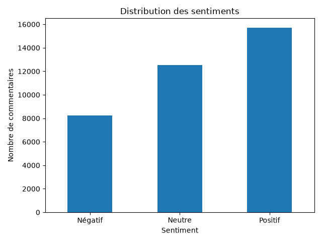

**Distribution de la longueur des commentaires**

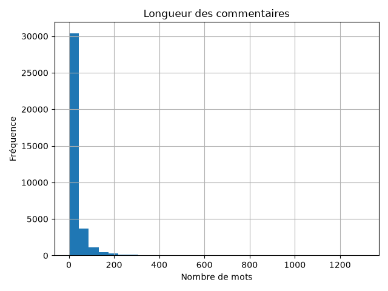

**Étape 3 – Prétraitement**

Nettoyage des commentaires et préparation des textes pour leur utilisation par les algorithmes de Machine Learning.

**Étape 4 – Entraînement**

Transformation des textes en représentations numériques à l'aide de TF-IDF, puis entraînement et comparaison de plusieurs algorithmes de classification.

**Étape 5 – Évaluation**

Évaluation des modèles à l'aide de plusieurs indicateurs :

- Accuracy
- Precision
- Recall
- F1-score
- Matrice de confusion
- Temps d'inférence

**Matrice de confusion du modèle**

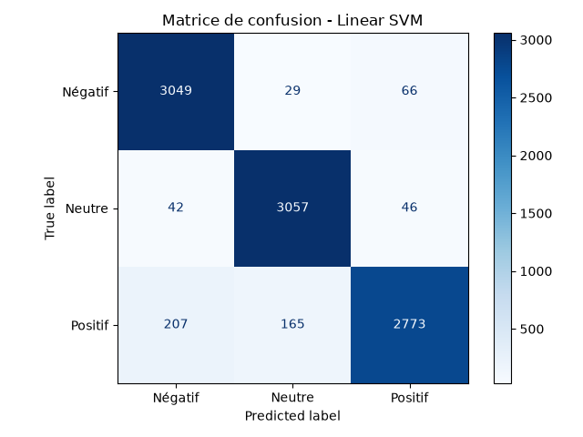


**Étape 6 – Sauvegarde**

Le modèle sélectionné est sauvegardé dans `models/best_model.joblib` afin de pouvoir être réutilisé par l'API sans devoir effectuer un nouvel entraînement.

## 6. Installation et utilisation

### 6.1. Prérequis

Avant de commencer, il faut disposer de :

- Python
- Git
- Docker
- Google Chrome

### 6.2. Cloner le projet

```bash
git clone https://github.com/marouaelhour/youtube-sentiment-analysis.git
cd youtube-sentiment-analysis
```

### 6.3. Créer un environnement virtuel


```bash
python -m venv venv
venv\Scripts\activate
```


### 6.4. Installer les dépendances

```bash
pip install -r requirements.txt
```

### 6.5. Lancer l'API localement

Pour utiliser l'API locale avec le point d'entrée du projet :

```bash
uvicorn src.api.main:app --reload
```

L'API est accessible à l'adresse :

`http://127.0.0.1:8000`

La documentation interactive Swagger est disponible à :

`http://127.0.0.1:8000/docs`

Pour vérifier son état :

```bash
curl http://127.0.0.1:8000/health
```

## 7. Déploiement avec Docker

L'application API est conteneurisée avec Docker afin de faciliter son exécution dans un environnement isolé.

### Construire l'image Docker

```bash
docker build -t youtube-sentiment-api .
```

### Lancer le conteneur

```bash
docker run -d -p 7860:7860 --name youtube-api youtube-sentiment-api
```

### Vérifier le conteneur

```bash
docker ps
```

### Vérifier le fonctionnement de l'API

```bash
curl http://localhost:7860/health
```

### Documentation Swagger

Lorsque le conteneur est démarré, la documentation est accessible à :

`http://localhost:7860/docs`

### Déploiement Cloud

L'API est exécutée dans un conteneur Docker au sein de GitHub Codespaces.

- **URL de l'API :** [Accéder à l'API](https://sturdy-space-palm-tree-7vgrvj576wxj3w59v-7860.app.github.dev)
- **Documentation Swagger :** [Consulter Swagger](https://sturdy-space-palm-tree-7vgrvj576wxj3w59v-7860.app.github.dev/docs)

**Remarque :** cette URL dépend du fonctionnement du Codespace et du conteneur Docker. Le service doit rester actif pour que l'API soit accessible.

## 8. Extension Google Chrome

L'extension permet d'utiliser le système directement depuis YouTube.

### Fonctionnalités principales

- Extraction des commentaires d'une vidéo YouTube.
- Analyse automatique des sentiments.
- Affichage du nombre et du pourcentage de commentaires positifs, neutres et négatifs.
- Filtrage des commentaires par sentiment.
- Affichage des résultats individuels.
- Mode clair et mode sombre.
- Copie des résultats de l'analyse.

### Installation de l'extension

1. Ouvrir Google Chrome.
2. Accéder à `chrome://extensions/`.
3. Activer le mode développeur.
4. Cliquer sur « Charger l'extension non empaquetée ».
5. Sélectionner le dossier `chrome-extension`.
6. Ouvrir une vidéo YouTube.
7. Cliquer sur l'icône de l'extension pour lancer l'analyse.

### Démonstration de l'application

**1. Analyse des commentaires YouTube**

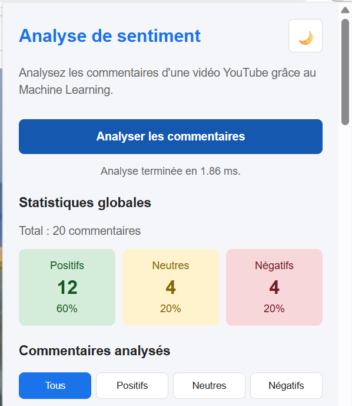

**2. Filtrage des commentaires par sentiment**


**3. Mode sombre**

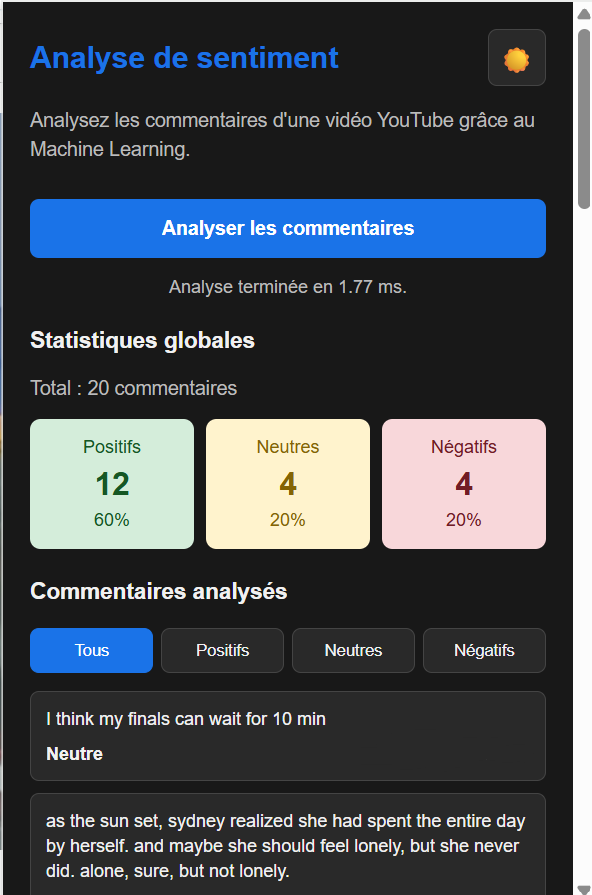

## 9. API REST – FastAPI

L'API assure la communication entre l'extension Chrome et le modèle de Machine Learning.

### Endpoints disponibles

| Méthode | Endpoint | Description |
|---|---|---|
| GET | `/health` | Vérifier l'état de l'API et le chargement du modèle |
| POST | `/predict_batch` | Analyser plusieurs commentaires |
| GET | `/docs` | Documentation interactive Swagger |

### Exemple de requête

```json
{
  "comments": [
    "This video is amazing!",
    "I hate this video.",
    "The video is okay."
  ]
}
```

### Démonstration de l'API

**Vérification de l'état de l'API**

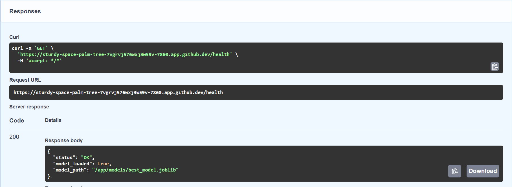

**Prédiction de plusieurs commentaires**

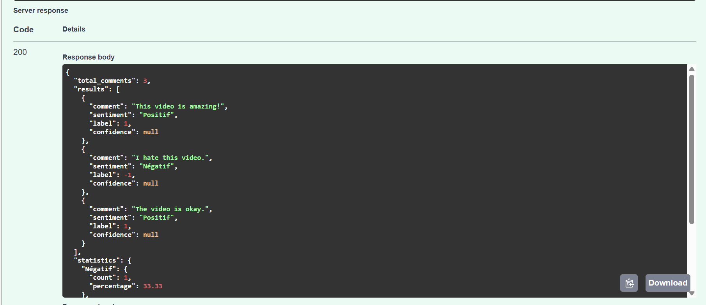

## 10. Tests et validation

Plusieurs tests permettent de vérifier le bon fonctionnement du système :

- Vérification de l'état de l'API avec `/health`.
- Tests de prédiction avec différentes tailles de lots.
  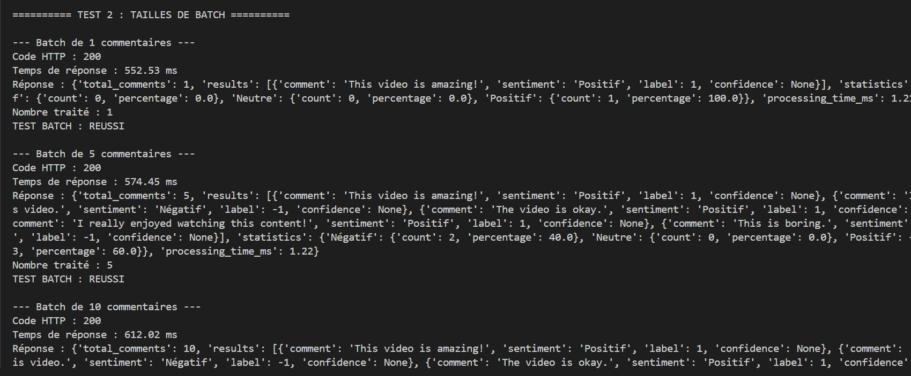
  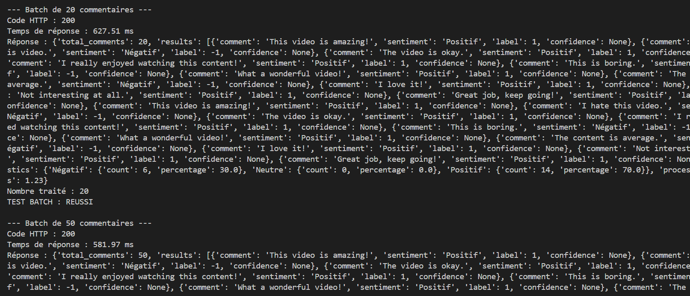
- Validation des entrées invalides et des commentaires vides.
  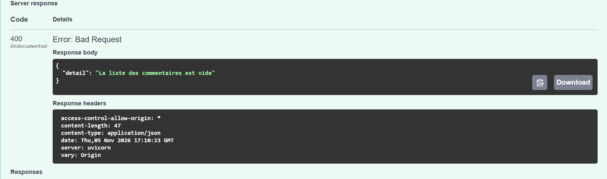
- Évaluation des performances du modèle.
- Mesure du temps d'inférence.
- Vérification du fonctionnement du conteneur Docker.
- Tests de l'extraction et de l'analyse des commentaires depuis YouTube.
- Vérification de la communication entre l'extension, l'API et le modèle.

### Vérification du déploiement Docker

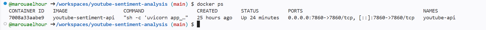

## 11. Perspectives d'amélioration

Plusieurs améliorations peuvent être envisagées :

- Tester des modèles de Deep Learning et des architectures Transformers.
- Améliorer la détection des commentaires neutres.
- Étendre l'analyse à plusieurs langues.
- Augmenter la taille et la diversité du dataset.
- Mettre en place un suivi continu des performances du modèle.
- Automatiser davantage le pipeline de déploiement.

